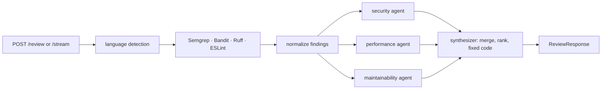

# Multi-Agent Code Review

Automated code review for Python and JavaScript. Static analysers (Semgrep, Bandit, Ruff, ESLint) feed three parallel
Gemini specialists (security, performance, maintainability); a synthesizer merges, ranks and proposes fixed code.
FastAPI backend with a JSON endpoint and an SSE stream, React + TypeScript UI.

The more interesting part is the evaluation, because **the multi-agent design did not beat the simpler alternatives.**

**Live demo: https://code-review-v2i1.onrender.com** (free instance: the first request after idle takes up to a minute, a review takes
about 30 seconds, and it is limited to 6 reviews/min per IP and 100/day overall).

## Does the multi-agent pipeline actually work better?

Four systems, scored on a held-out set of 67 files (56 labelled issues, 14 clean files) written for this project after
the static rules were frozen. Scoring is strict: a prediction counts only if file, category and vulnerability class
match a label within ±3 lines. Brackets are 95% bootstrap intervals over files.

| system | what it is | precision | recall | F1 | clean files with a false alarm | LLM calls / file | latency |
|---|---|---|---|---|---|---|---|
| `tools_only` | the four static analysers, no LLM | 0.68 [0.53–0.84] | 0.68 [0.55–0.81] | **0.68** [0.56–0.78] | 4 / 14 | 0 | 1.1 s |
| `single_llm` | one Gemini call, one generic prompt, no tools | 0.59 [0.48–0.70] | 0.84 [0.73–0.93] | **0.70** [0.59–0.79] | 12 / 14 | 1 | 2.6 s |
| `multi_agent_no_tools` | the full graph, static findings withheld | 0.22 [0.17–0.27] | 0.73 [0.62–0.84] | **0.34** [0.27–0.40] | 14 / 14 | 4 | 17 s |
| `multi_agent` | the full system | 0.25 [0.19–0.30] | 0.79 [0.67–0.89] | **0.37** [0.29–0.45] | 14 / 14 | 4 | n/a† |

† Replayed from cache, so no latency was recorded. The no-tools variant measured 17 s per file live.

**What this says**

- **One prompt matches the static tools, and the pipeline does worse than either.** `single_llm` and `tools_only` have
  indistinguishable F1 (0.70 vs 0.68). The full pipeline's F1 interval (0.29–0.45) does not overlap theirs.
- **The pipeline's recall is fine; its precision is not.** It finds as much as the others (recall 0.79, intervals overlap
  with `single_llm`) but reports about three issues per clean file, and every clean file got at least one.
- **Grounding in static analysis helps a little, not provably.** Adding the analysers' output moved precision 0.22 → 0.25
  and recall 0.73 → 0.79. The intervals overlap, so this is not shown to differ.
- **It is not a line-matching artifact.** In files that have labels, no false positive is a labelled class reported near the
  right line. 96 of the 135 false positives are findings
  the closed vocabulary cannot classify ("Missing Rate Limiting" alone is 19), which a stricter reading counts against
  precision. Dropping all of those from every system (`evaluation/sensitivity.py`) gives `multi_agent` 0.53 against 0.78
  for `single_llm` and 0.70 for `tools_only`: the order does not change. I read three of the 14 clean files
  (`t02`, `t03`, `t04`: `execFile` with an argument list, parameterized SQL, a validated redirect); the code is safe and the
  findings are wrong. I did not adjudicate the other false positives one by one.
- **The tools alone are not "good enough" either.** They miss most performance problems (recall 0.13 on 15 labels) and
  alarm on 4 of 14 clean files. The LLMs recover performance recall (0.47–0.53) at the cost of noise.

Why the pipeline is noisy is untested. My guess is that each specialist, asked to review its own domain, nearly always
returns something; prompts that permit an empty result, or a synthesizer that filters, are the obvious experiments. Any such change spends the `test` split: it would need a fresh held-out set.

**Read before quoting these numbers.** One labeler (no inter-annotator agreement), synthetic single-purpose files, 67 files
is small, one run per system with a small "flash-lite" model, and the labels and the static rules share an author.
Maintainability is generated but not scored. The full protocol, the dev split, per-class recall and every false positive
are in [`evaluation/README.md`](evaluation/README.md), [`evaluation/results/RESULTS.md`](evaluation/results/RESULTS.md) and
[`evaluation/results/errors.md`](evaluation/results/errors.md).

**Reproduce it without an API key.** Every Gemini response is cached and committed, and a replay reproduces every
prediction exactly (checked: 4 systems × 97 files, 0 differences):

```bash
make install                                   # venv + dependencies; ESLint separately: npm i -g eslint
cd evaluation
python run_eval.py --system all --offline      # replay the committed cache, no key, no network
python compute_metrics.py                      # -> results/RESULTS.md
```

## How it works



- `server/tool_runner.py` runs the analysers with bundled rules (`server/rules/`); a tool that fails is reported in
  `warnings`, never silently treated as "no findings".
- `server/agents/` holds one implementation of the specialist (`base.py`), the prompts, and the LangGraph fan-out/fan-in.
  `server/llm.py` is the only code that talks to Gemini (retry, rate-limit waits, JSON extraction).
- If every specialist fails, `/review` returns **502** and `/stream` emits an `error` event. A failure never looks like a clean review.
- `server/pipeline.py` is shared by the API and the evaluation, so the numbers above come from the code that serves requests.
- Runtime model: `gemini-3.1-flash-lite` (`GEMINI_MODEL` to override).

## Run it

You need a [Gemini API key](https://aistudio.google.com/apikey).

```bash
cp .env.example .env            # put GEMINI_API_KEY in it
docker compose up --build       # http://localhost:8000
```

Or without Docker (Python 3.10+, Node 22):

```bash
make install && npm i -g eslint
make run                        # builds the UI, serves everything on http://localhost:8000
make dev                        # API with reload; `cd client && npm run dev` for the UI on :5173
make test                       # server, evaluation and dataset checks, all offline
```

```bash
curl -X POST localhost:8000/review -H 'Content-Type: application/json' \
  -d '{"code": "import os\nos.system(input())", "filename": "t.py"}'
```

`POST /stream` sends Server-Sent Events: `language`, `tools_done`, `security_done`, `performance_done`,
`maintainability_done`, `synthesis_done`, `done`, or `error`. Responses carry `warnings` when a tool or an agent did not run.

## Deploying

The repository ships one Docker image (API, analysers and built UI on one port; non-root; no secrets baked in) and a
[`render.yaml`](render.yaml) blueprint: in Render, New → Blueprint → this repo, then enter `GEMINI_API_KEY`. The free instance
has 512 MB; two simultaneous reviews fit (tested with `docker run --memory=512m`).

A public instance can spend your Gemini quota, so it is limited by environment variables (`0` disables each; all in
[`.env.example`](.env.example)): 20 000 characters per submission, 6 reviews/min per IP, 100 reviews/day overall, 3 at a time.
Set `TRUST_PROXY_HEADERS=true` only behind a proxy that sets `X-Forwarded-For`.

CI ([`.github/workflows/ci.yml`](.github/workflows/ci.yml)) runs the server and evaluation tests with the real analysers,
checks the generated dataset files, builds the client, and smoke-tests the image without any API key.

## Limitations

- Python and JavaScript only. TypeScript files are routed to the JavaScript path, but the ESLint configuration parses plain
  JavaScript, so they produce parse errors.
- The evaluation is small and synthetic (see above). It says little about large real-world repositories.
- Large inputs can hit the model's output limit; truncated output is retried rather than repaired.
- In-memory rate limits are per process: one container, not a fleet.
- The specialist prompts still describe the performance agent as receiving only ESLint findings, although Ruff findings now
  reach it. They were left unchanged on purpose: any edit invalidates the evaluation cache.

## Repository layout

```
server/       FastAPI app, pipeline, agents, bundled Semgrep rules, tests
client/       React + Vite + TypeScript UI
evaluation/   dataset (annotated source), runner, scorer, results, committed LLM cache
scripts/      image smoke test
docs/         HANDOFF.md: working notes for continuing the project
```

## Provenance

The initial pipeline was imported from another repository (see the first commit). The fixes for silent failures and wrong
results, the evaluation (dataset, scorer, baselines, harness), the request limits and the packaging are later work, in the
commits after it.
